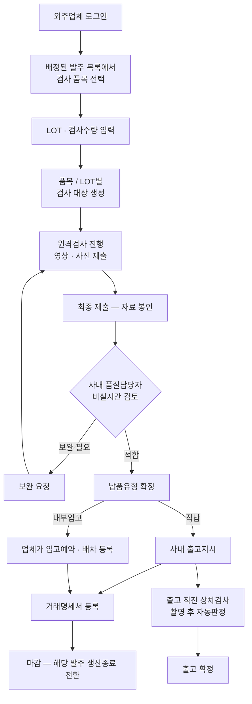

# 외주 통합관리 시스템 — 업무 흐름 설계

> **설계 단계 문서입니다.** 사내 시스템이므로 화면·소스·데이터는 공개하지 않으며,
> 이 문서는 **업무 흐름과 설계 판단만** 정리한 것입니다.

---

## 1. 구축 배경

외주 업무가 구간마다 다른 곳에 흩어져 있습니다. 발주는 엑셀, 검사는 수기, 정산은 또 다른 곳입니다.
**같은 사실을 여러 곳에 따로 적는 일**이 반복되고, 그 과정에서 숫자가 어긋납니다.

목표는 발주부터 지급까지를 **한 시스템에서 끝내는 것**입니다.

```
발주 → 생산 시작 → 품질검사 → 출고 → 마감 정산 → 지급
```

1차 구축 범위는 그중 **품질검사와 거래명세서 등록**까지로 잡았습니다.
현장 업무 흐름을 먼저 검증해야 나머지를 붙일 수 있기 때문입니다.

---

## 2. 전체 업무 흐름



**설계 결정** — 거래명세서는 검사의 **입력물이 아니라 산출물**입니다.
검사를 마친 LOT만 명세서에 올릴 수 있도록 순서를 고정했습니다.
이렇게 하지 않으면 검사 없이 명세서가 먼저 나가는 경로가 열립니다.

---

## 3. 사용자와 역할

| 구분 | 하는 일 |
| --- | --- |
| **외주업체** | 검사 대상 생성 · 원격검사 수행 · 보완 대응 · 거래명세서 작성 · 입고예약 |
| **사내 품질담당자** | 제출 자료 검토 및 판정 · 보완 요청 |
| **사내 물류팀** | 직납 건 명세서 접수 · 고객사 배정 · 배차 |
| **사내 관리자** | 업체 계정 발급 · 기준정보 관리 |

외주업체는 **업체당 계정 하나**를 원칙으로 하고, 사내 임직원과 외부 업체의 인증 경로를 분리했습니다.
사내는 회사 계정 통합 인증, 외부 업체는 이메일로 받은 인증코드 방식입니다.

---

## 4. 검사 유형

성격이 다른 검사를 한 메뉴에 담으면 둘 다 불편해집니다. 별도로 두었습니다.

| 구분 | 사전컨펌검사 | 원격검사 |
| --- | --- | --- |
| 목적 | 양산 전 초동품 확인 | 납품분 기준 검사 |
| 시점 | 본생산 투입 전 | 납품 시점 |
| 자료 | 사진 | 영상 중심 (사진 병행) |
| 범위 | 좁음 | 넓음 (공통 + 품목별 단계) |

**독립적으로 운영합니다.** 사전컨펌 적합이 원격검사의 선행 조건은 아닙니다.
다만 원격검사 시작 시 같은 품목의 사전컨펌 건을 불러와 나란히 참조할 수 있게 했습니다.

---

## 5. 주요 설계 결정

| 항목 | 판단 | 이유 |
| --- | --- | --- |
| **비실시간 검사** | 업체가 올리고, 담당자가 나중에 본다 | 실시간 영상 검사는 양측 일정을 맞춰야 해 운영이 안 된다 |
| **제출 후 봉인** | 최종 제출하면 자료를 고칠 수 없다 | 증빙 무결성. 판정 근거가 사후에 바뀌면 안 된다 |
| **LOT 단위 관리** | 품목으로 묶고 그 안에서 LOT별로 행을 나눈다 | 판정과 추적의 최소 단위가 LOT이다 |
| **명세서는 산출물** | 검사 완료 LOT만 명세서에 올린다 | 검사를 건너뛰는 경로를 원천 차단 |
| **데이터 소유권 분리** | 발주 정보의 원본은 기존 시스템, 검사 결과는 이 시스템 | 양쪽이 같은 값을 각자 쓰면 반드시 어긋난다 |

---

## 6. 데이터 축적 방향

지금은 사람이 판정하지만, 검사 자료가 품목·LOT·검사항목 단위로 정리되어 쌓이면
**향후 검사 자동화의 학습 데이터**가 됩니다. 그래서 초기 설계부터
항목 체계와 저장 구조를 그 전제에 맞췄습니다.

---

## 7. 산출물

| 산출물 | 분량 |
| --- | --- |
| 화면정의서 | 42종 |
| 클릭 가능한 화면 시안 | 57종 |
| 아키텍처 설계 | — |
| DB 구조 검토안 | — |
| 검사항목 × 설비유형 매핑 (품질보증팀 검토) | — |

화면 산출물은 사내 자료라 이 저장소에 포함하지 않습니다.
