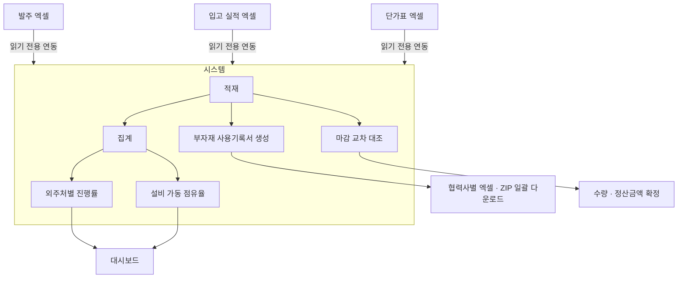

# 외주 생산관리 대시보드 — 시스템 개요

> **운영 중인 사내 시스템입니다.** 소스·화면·데이터는 공개하지 않으며,
> 이 문서는 **업무 흐름과 설계 결정만** 정리한 것입니다.
> 기획·설계·개발·배포·운영을 단독으로 수행했습니다.

---

## 1. 구축 배경

외주 발주와 입고 실적이 월별 엑셀 파일에 흩어져 있었습니다.
지금 어느 외주처가 얼마나 진행됐는지 알려면 매번 파일을 열어 수기로 집계해야 했고,
부자재 사용기록서도 협력사별로 일일이 만들어 보내는 구조였습니다.

**기존 엑셀 업무 방식은 그대로 두고, 집계와 문서 생성만 자동화**하는 방향으로 잡았습니다.
현장에서 쓰던 파일을 바꾸라고 하면 도입이 되지 않기 때문입니다.

---

## 2. 업무 흐름

원본은 엑셀이고 **시스템은 읽어서 적재만** 합니다. 원본을 고치지 않습니다.
예외는 둘 — 부자재 기록서 생성 여부와 마감 단가는 **원본 엑셀에 없는 항목**이라
시스템에서만 관리합니다.

---

## 3. 화면 구성

운영 19개 + 확장 계획 4개, 총 23개 화면입니다.

| 묶음 | 화면 |
| --- | --- |
| 대시보드 | 메인 대시보드 · 일별 현황 |
| 발주 | 발주관리(30열 원장) · 발주 등록/수정 |
| 입고 | 입고현황(26열 원장) · 입고 실적 등록 · 출력변환 |
| 마감 | 마감 · 마감 상세내역 · 단가관리 · 단가 등록/수정 |
| 외주처 | 외주처관리 · 상세 · 등록/수정 |
| 관리자 | 계정 관리 · 메뉴 공개 설정 · 월 지표 집계 · 운영 DB 조회 |
| 확장 계획 | 생산계획 · 투입공수 · 수율 · 완납률 |

---

## 4. 집계 규칙

모든 화면이 같은 규칙을 씁니다. 두 화면의 숫자가 다르면 **자료가 다른 것이지
계산이 다른 것이 아니도록** 한 곳에서 정의했습니다.

| 항목 | 계산식 |
| --- | --- |
| 입고 진행률 | `입고수량 ÷ 발주수량 × 100` |
| 설비 점유율 | `입고수량 ÷ (일 CAPA × 누적 조업일)` |
| 발주 점유율 | `발주수량 ÷ (일 CAPA × 누적 조업일)` |
| 일 CAPA | `Σ (라인수 × 라인당 CAPA)` — 설비 10종 |
| 누적 조업일 | 기준월 1일부터 기준일까지의 월~금 일수 |

### 집계에서 걸러내는 것과 그 이유

| 규칙 | 이유 |
| --- | --- |
| 취소 · 외주처 이동 건 제외 | 옮긴 건은 옮겨 간 쪽에 새 발주로 잡혀 둘 다 세면 중복된다 |
| 실적 배분은 FIFO | 같은 협력사 × 제품의 분할 발주에 발주일 순으로 채운다 |
| CAPA 미등록 업체는 분자에서도 제외 | 분모만 빠지면 전체 점유율이 실제보다 높게 나온다 |
| 표준 설비 10종 외 유형은 점유율 공란 | 임의 분모를 쓰면 수치가 왜곡된다 |
| 발주내역에 없는 입고는 표 끝에 별도 표기 | 분자에만 잡혀 진행률이 100%를 넘는 이유를 보이게 한다 |
| 입고일자에 글자가 섞인 행도 집계 | '직납·환입' 같은 메모가 날짜 비교에서 탈락한다 |

### 마감 교차 대조

기준 파일 5종을 대조해 수량·정산금액을 확정합니다.

| 판정 | 조건 |
| --- | --- |
| 일치 | 외주 수량 = 내부 입고 |
| 수량불일치 | 둘 다 0보다 큰데 값이 다름 |
| 외주누락 | 외주 수량 0 · 내부 입고 있음 |
| 내부누락 | 내부 입고 0 · 외주 수량 있음 |

**불일치가 남아 있어도 확정은 막지 않습니다.** 확인 창만 띄웁니다.
차이를 남긴 채 월을 닫아야 하는 경우가 있어 판단을 사람에게 맡겼습니다.

---

## 5. 주요 설계 결정

| 항목 | 결정 | 이유 |
| --- | --- | --- |
| **데이터 원본** | 엑셀이 원본, 시스템은 읽어 적재만 | 현장 업무 방식을 바꾸지 않아야 도입된다 |
| **기준월 자동 판정** | 적재된 발주번호의 최신 월 | 월 선택 드롭다운을 두면 선택 실수가 생긴다 |
| **입고 집계 범위** | 모수는 기준월, 분자는 그 이후까지 이어서 | 다음 달 자료가 없어도 진행률이 멈춰 보이지 않는다 |
| **금액 노출 차단** | 조회 권한에는 **서버 응답에서 금액을 지운다** | 화면에서 가리는 것만으로는 우회된다 |
| **두 겹 차단** | 화면에서 버튼을 가리고 + 서버에서 동작을 막는다 | 주소를 직접 불러 우회하는 경로를 닫는다 |
| **차트를 라이브러리 없이 SVG로 직접 생성** | 외부 CDN 미사용 | 사내망에서 외부 주소가 막히면 화면이 빈다 |
| **자기 계정 보호** | 관리자가 자기 권한 변경·삭제 불가 | 스스로 조회 권한으로 내리면 되돌릴 방법이 없다 |

### 권한 4단계

| 역할 | 범위 |
| --- | --- |
| 관리자 | 전체 + 계정·메뉴 공개 설정 |
| 운영 | 관리자 메뉴 제외 전체. 금액 표시 |
| 조회 | 발주관리 · 입고현황만. **금액은 응답에서 제거되어 전달** |
| 승인 대기 | 로그인 차단 |

첫 로그인 시 가입 신청이 자동 생성되고, 관리자가 역할을 지정해 승인합니다.

---

## 6. 기술 구성

| 영역 | 사용 |
| --- | --- |
| 백엔드 | Flask · SQLAlchemy · Flask-Login · gunicorn |
| 데이터 | PostgreSQL (집계 · 마감 이력 · 계정 · 지표) |
| 원본 연동 | Microsoft Graph → 엑셀 3종 (읽기 전용) |
| 프론트 | Jinja2 템플릿 + Vite/React (일부 화면 점진 도입) |
| 문서 처리 | pandas · openpyxl · pdfplumber · 생성형 모델(출력변환) |
| 차트 | SVG 직접 생성 (외부 라이브러리 없음) |
| 배포 | Docker · AWS App Runner |
| 인증 | 회사 계정 OIDC 인증 코드 흐름 |

**작업 기록**: 업무 API 전체에 1계층 감사, 생성·수정·삭제·승인·다운로드·권한 변경은
2계층으로 별도 기록합니다. 로그인은 계정·접속지 각각 5회 실패 시 15분 잠금이며,
실패 사유는 구분해 알려주지 않습니다(계정 열거 방지).

---

## 7. 알려진 제약

| 항목 | 현재 상태 |
| --- | --- |
| 동기화 | 날짜가 바뀐 뒤 첫 진입 때 1회. 당일 중 원본 변경은 다음 날 반영 |
| 공휴일 | 조업일을 월~금으로만 센다. 공휴일이 끼면 CAPA가 크게 잡혀 점유율이 낮게 나온다 |
| 업로드 파일 | 마감 기준 파일은 재배포 시 비워진다 (확정된 마감 이력은 DB에 남음) |
| 발주메일 발송 | 정합성 검토 미완으로 기본 비활성 |
| 생산 영역 | 생산계획·투입공수·수율·완납률은 화면만 있고 업무에 쓰지 않음 |

공휴일 미반영은 알고 남겨 둔 것입니다. 조업일 기준을 바꾸면 과거 집계와
비교가 끊기므로, 기준 변경 시점을 따로 정해야 합니다.
